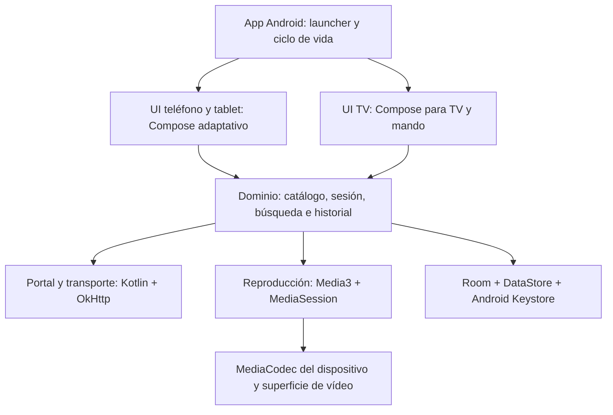

# XuperAndroid: arquitectura propuesta y compatibilidad con Tizen 10

Investigación del 24 de noviembre de 2026. Esta es una definición de arquitectura y de pruebas; todavía no es un APK implementado ni una certificación de dispositivos.

## Versiones verificadas

| Plataforma | Evidencia oficial | Consecuencia |
|---|---|---|
| Android 17 | Google anunció su lanzamiento el 16/06/2026; SDK API 37 | Compilar y orientar la nueva app a API 37, con pruebas de sus cambios de comportamiento |
| Android 16 | API 36 | Incluirlo en la matriz de compatibilidad |
| Android 15 | API 35 | Probar diseño edge-to-edge, insets y navegación del sistema |
| Android 8 | API 26 | Mínimo propuesto para equilibrar compatibilidad y mantenimiento; no significa que todos sus equipos tengan los mismos códecs o rendimiento |
| Media3 | La página oficial publica 1.11.1 como estable y 1.12.0-beta01 como beta | Usar una versión estable verificada al crear el build; no adoptar la beta por ser el número mayor |
| Samsung Tizen 10 | Modelos 2026; Chromium M130 | Base favorable para nuestra interfaz compilada a Chromium M56, pero requiere validación de APIs y reproducción |

Las páginas de notas beta de Android 17 siguen accesibles. Para establecer que la versión ya se lanzó se utilizó el anuncio oficial de lanzamiento, no la mera existencia de esas páginas. `minSdk`, `targetSdk` y `compileSdk` son conceptos distintos: orientar a Android 17 no obliga a instalar Android 17 en todos los dispositivos.

## Dispositivos objetivo

- Teléfonos Android 8 o posteriores: distribución APK y controles táctiles; soporte final sujeto a pruebas y disponibilidad de códecs.
- Lenovo Tab P11: la ficha de Lenovo del modelo original indica Android 10 o posterior, dentro del mínimo propuesto. Generación, memoria y actualización real deben registrarse al probar; P11, P11 Plus y P11 Pro no son el mismo equipo.
- TCL Android TV / Google TV: misma base Android, interfaz de mando, foco visible y launcher TV. Registrar modelo y versión real.
- TCL Roku TV: requiere otro cliente para Roku; no instala un APK Android.
- TCL con Fire TV: evaluar un flavor específico sin dependencia obligatoria de servicios Google. No certificarlo por la marca TCL.
- Samsung Tizen: mantiene el cliente WGT actual; no instala el APK Android.

## Decisión de arquitectura

Recomiendo Kotlin, interfaz Jetpack Compose y Media3/ExoPlayer para TV y VOD. Mantener la identidad visual y los tres menús TV / Películas / Series, búsqueda y ajustes. Compose adaptativo para teléfono/tablet y componentes de TV para mando. La apariencia existente se reproduce con tokens de color, espaciado y tipografía; CSS/shadcn y HTML no se convierten automáticamente en componentes nativos.

Lo reutilizable de Tizen/Windows es el contrato del portal, sus modelos, reglas, fixtures de prueba, catálogo, criterios de calidad, preferencias y comportamiento de reproducción. Los adaptadores de plataforma, la UI nativa y la persistencia Android requieren implementación. No se reutiliza Electron ni se asume que el binario libmpv de Windows sirva para Android.

Una envoltura WebView puede reutilizar más HTML a corto plazo, pero no es la base recomendada para este proyecto de móvil/tablet/TV a largo plazo. Si se elige posteriormente esa alternativa, debe tener assets locales, bridge con origen restringido y reproducción nativa; no exponer funciones nativas a páginas remotas ni depender del reproductor HTML para todos los códecs.



### Módulos propuestos

```text
android/
  app/                       launcher móvil/TV, composición de dependencias
  core/model/                Title, Episode, Channel, StreamDescriptor, PlaybackSnapshot
  core/portal/               sesión propia, perfil del portal, respuestas y catálogo
  core/network/              OkHttp, DNS, autorización, cancelación y redirecciones
  core/storage/              Room, DataStore y almacenamiento de credenciales
  core/player/               Media3, pistas, subtítulos, búfer, recuperación y MediaSession
  core/design/               identidad visual y componentes compartidos
  feature/catalog/           películas, series, categorías y seguir viendo
  feature/live/              categorías y canales en vivo
  feature/details/           ficha, temporadas, capítulos y similares
  feature/search/            búsqueda y filtros sin historial de consultas
  feature/settings/          reproducción, limpieza y diagnósticos
  ui/mobile/                 adaptación táctil y ventanas compactas/medianas
  ui/tv/                     foco, mando, filas y ventanas amplias
```

Los nombres son un esquema de módulos, no carpetas Android ya implementadas en el repositorio.

## Portal y red

1. Portar el protocolo propio a Kotlin con pruebas de equivalencia contra fixtures del cliente JavaScript. Mantener un solo modelo de sesión.
2. Separar versión de nuestra APK, SDK de Android y perfil declarado al portal. Cambiar `targetSdk` a 37 no sustituye automáticamente `apkVersion`, `apkVer` o `spkgVer` del protocolo.
3. Conservar el manejo de réplicas: un host que rechaza la versión no cancela a los demás ni se promueve como preferido. Respetar errores regionales y de autorización.
4. Mantener autorización por CDN sin mezclar credenciales entre hosts o entre títulos. Cancelar operaciones al cambiar de canal o ficha.
5. Usar DNS del sistema y la alternativa segura validada cuando corresponda, preservando Host/SNI y verificación TLS. El DNS no elimina una restricción regional del servicio.
6. Manejar explícitamente los endpoints HTTP heredados que realmente exija el proveedor; no habilitar tráfico inseguro global sin revisar su alcance.
7. Identidad propia por instalación y sesión propia; no importar sesiones, identificadores privados ni claves de otros APK.
8. No descargar el catálogo completo para pintar la portada: consultas paginadas, índices locales acotados y cancelación de búsquedas obsoletas.

## Reproductor nativo

Media3/ExoPlayer será el motor inicial para TV, películas y series, con MediaCodec para decodificación por hardware cuando esté disponible. HLS, DASH, MP4 y MPEG-TS se evalúan según fuente y dispositivo. Que una versión de Android sea compatible no prueba soporte de HEVC, HDR, Dolby, 4K o una licencia DRM concreta.

Contrato de plataforma propuesto:

```text
prepare(stream, resumePosition)
play() / pause() / stopAndRelease()
seek(position) -> pendiente / confirmado / fallido
selectAudio(trackId)
selectSubtitle(trackId | desactivados)
setSubtitleStyle(font, size, color)
observeSnapshot() -> posición, duración, reserva, pistas, resolución, FPS si disponibles
```

- Confirmar los saltos con el estado y posición reales del motor; no simular el reloj en la UI. El seek también depende del archivo, su índice y el soporte de rangos del servidor.
- Un único reproductor principal; liberar el título anterior antes de preparar el siguiente. Mantener checkpoint y generaciones de solicitudes para ignorar respuestas antiguas.
- Superficie de vídeo y controles compuestos en el mismo árbol Android. El botón de siguiente capítulo es una superposición pequeña, sin recortar una franja completa de la imagen.
- Audio: español latino cuando esté identificado; español genérico no se etiqueta como latino sin evidencia. Conservar selección manual por película/serie.
- Subtítulos: apagados por defecto con audio español; aplicar la regla de fallback definida por el usuario y respetar su cambio manual. No inventar subtítulos forzados.
- Preferencias de fuente, tamaño y color sobre un único renderizador de subtítulos para evitar dobles selecciones o doble dibujo.
- MediaSession, foco de audio, Bluetooth, desconexión de audífonos y pausa ante interrupciones. Picture-in-picture móvil como función posterior, con permisos y ciclo de vida propios.
- Siguiente capítulo solo para series. Umbral por duración y metadatos reales disponibles, preservando la elección del usuario.

### Memoria y caché

No copiar sin medir los presupuestos de Windows a un televisor Android o teléfono de poca RAM. Obtener la clasificación de memoria del dispositivo y perfilar Media3, decodificador e interfaz.

Propuesta inicial para perfilar: objetivos de reserva más pequeños en equipos de poca memoria, ampliables en tablet/teléfono con más RAM; límites de bytes explícitos y una única instancia del motor. Los valores finales deben surgir de las pruebas, no de una promesa universal de minutos.

La reserva temporal se informa con `bufferedPosition - currentPosition` cuando el motor lo permita. Descargar muchos MiB no equivale a tener esos minutos disponibles. Una caché de disco opcional debe tener LRU y tamaño máximo, sin guardar manifiestos caducados como fuentes permanentes. El límite del búfer no es el límite de RAM total: hay memoria adicional de decodificación, superficies, imágenes e interfaz.

Limpiar recursos temporales al cerrar un vídeo y la app; conservar favoritos, progreso y preferencias. El cierre Android usa el ciclo de vida y sus callbacks, no una terminación forzada del proceso.

## Interfaz por dispositivo

- Conservar TV, Películas y Series, lupa y ajustes. En ventanas estrechas, separar la fila de acciones y los tres tabs; en tablet/TV pueden compartir la cabecera amplia.
- Medir la ventana disponible, no fijar píxeles por marca o diagonal. Adaptar orientación, multitarea, recortes, barras del sistema e insets.
- Tablet P11: permitir orientación horizontal/vertical, grid adaptable y navegación táctil.
- TV: recorrido D-pad completo, foco visible, restauración de selección, listas virtualizadas y carga paginada. No exigir touchscreen en el manifest. Declarar launcher TV y tratar Leanback como opcional si se distribuye el mismo APK a móviles.
- Gestión de «Seguir viendo»: pulsación prolongada en táctil y OK prolongado en TV. Confirmar eliminación del elemento, no borrar toda la biblioteca por accidente.
- Respetar la navegación atrás y el gesto predictivo del sistema. Si se mantiene doble atrás para salir en la raíz, no interceptar la navegación normal de menús o teclado.

## Persistencia

Room para favoritos, historial, progreso, temporadas/episodios y metadatos acotados. DataStore para ajustes. Android Keystore para proteger material sensible cuando sea necesario. Migraciones versionadas desde la primera beta.

Guardar explícitamente el tipo película/serie para que una película no aparezca en «Seguir viendo» de series. Guardar episodio y temporada separados del título visible. Una limpieza de caché no borra estas tablas. El historial del contador mantiene la política de registros acordada y no cuenta duplicados como títulos únicos.

## Construcción y validación

- `compileSdk = 37`, `targetSdk = 37`, `minSdk = 26` como configuración propuesta.
- APK instalable y, si se publica en una tienda, AAB. La aplicación Java/Kotlin puede cubrir ARM de 32/64 bits sin añadir un motor nativo propio. Si más adelante se incorporan bibliotecas C/C++, deben compilarse por ABI y cumplir los requisitos de páginas de memoria de Android moderno.
- Evitar dependencias obligatorias de Google Play Services para que el catálogo y la reproducción no dependan de ellas.
- Firma propia estable, versión de aplicación independiente de Tizen/Windows y conservación del perfil al actualizar.
- Declarar launcher móvil y LEANBACK_LAUNCHER para TV, banner/icono TV, pantalla táctil no obligatoria y leanback no obligatorio en el paquete universal. La compatibilidad real se detecta por UiMode y capacidades.
- Probar Android 8 de pocos recursos; Tab P11 real; teléfono reciente Android 16/17; Android TV/Google TV de distintas versiones; TCL real con mando. Añadir emulador x86_64 para automatización, sin confundirlo con prueba de códecs de todos los equipos.
- Casos mínimos: TV prolongada, VOD largo, seeks 40/110/60 min, pausa y reserva, cambio de canal, cambio de capítulo, audio/subtítulos, giro/multiventana, background/reanudación y restauración tras muerte del proceso.

Fases: contrato y fixtures; aplicación mínima con reproducción local/fixture; portal/catálogo; UI adaptativa; pruebas físicas y beta firmada. No se declara una beta lista hasta tener un APK compilado e instalado.

## Samsung Tizen 10: conclusión sobre el cliente existente

La app declara `required_version="4.0"` en `app/config.xml` y se compila a Chrome 56 en `tools/build-standalone.mjs`. Samsung documenta Tizen 10.0 para modelos 2026 con Chromium M130. Esto es una buena base de compatibilidad para HTML/CSS/JavaScript, no un motivo para reconstruir toda la interfaz.

No permite prometer «sin problemas»: verificar AVPlay y sus propiedades/cabeceras, HLS.js/MPEG-TS/MSE, códecs del modelo, workers/WebAssembly, TLS/CSP, almacenamiento, mando y reanudación tras suspensión. Comparar contra un TV existente para detectar regresiones. La instalación/firma del WGT y el modo desarrollador se comprueban aparte.

La compatibilidad del sistema y la aceptación del perfil por el portal son comprobaciones separadas. Un firmware nuevo no garantiza que el proveedor acepte una versión antigua del cliente. Revisar el artefacto WGT efectivamente instalado, además del código actual del repositorio; este documento no actualiza la descarga publicada.

La existencia de Tizen 10 no implica que todos los televisores Samsung antiguos reciban ese firmware. La actualización y sus fechas dependen del modelo, mercado y soporte del fabricante. La prueba final debe hacerse con el modelo y firmware reales; un emulador por sí solo no certifica reproducción ni hardware.

## Fuentes oficiales consultadas

- Android 17, anuncio de lanzamiento: https://android-developers.googleblog.com/2026/06/Android-17.html
- SDK Android 17 / API 37: https://developer.android.com/about/versions/17/setup-sdk
- Plataformas Android / API 36 y 35: https://developer.android.com/tools/releases/platforms
- Media3, versiones estables y beta: https://developer.android.com/jetpack/androidx/releases/media3
- Compose adaptativo: https://developer.android.com/develop/ui/compose/layouts/adaptive
- Compose para TV: https://developer.android.com/training/tv/playback/compose
- Hardware/manifest TV: https://developer.android.com/training/tv/start/hardware
- WebView local y seguridad de bridges, para evaluar la alternativa híbrida: https://developer.android.com/develop/ui/views/layout/webapps/load-local-content y https://developer.android.com/privacy-and-security/risks/insecure-webview-native-bridges
- Lenovo Tab P11, especificación original: https://psref.lenovo.com/syspool/Sys/PDF/Lenovo_Tablets/Tab_P11/Tab_P11_Spec.pdf
- Samsung, motor web por año/plataforma: https://developer.samsung.com/smarttv/develop/specifications/web-engine-specifications.html
- Samsung, grupos de modelos/Tizen 10: https://developer.samsung.com/smarttv/develop/specifications/tv-model-groups.html
- Samsung AVPlay: https://developer.samsung.com/smarttv/develop/api-references/samsung-product-api-references/avplay-api.html
